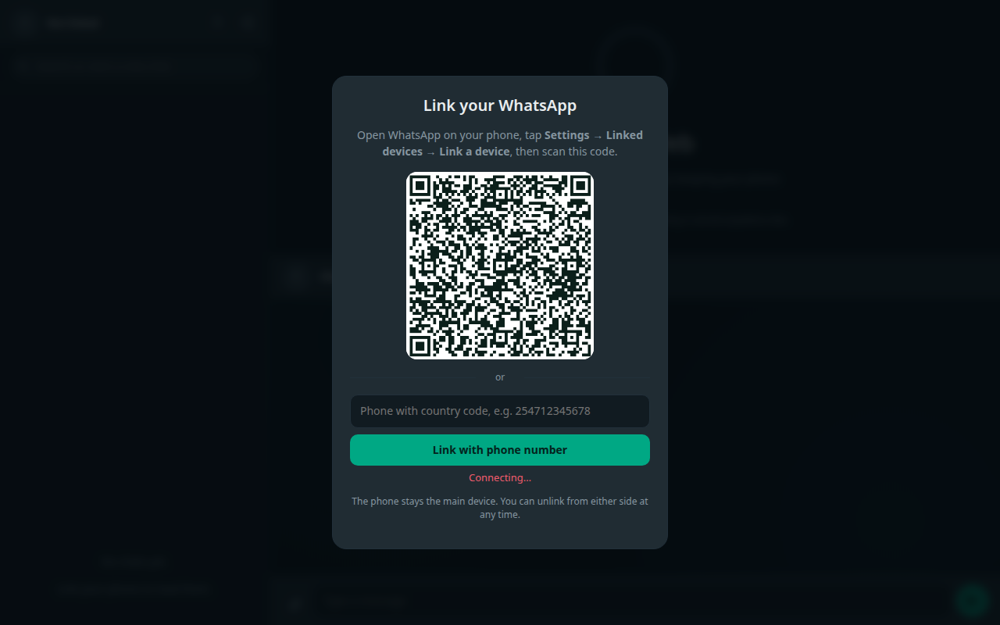

# WhatsWeb

A self-hosted WhatsApp Web. Link a number the same way the real site does — scan a QR code or type the pairing code — then read and send messages from the browser.



## What it does

- **Link a device** with the QR code, or with a phone number and an 8-character pairing code
- **Chat list** with avatars, last message, unread counts, search, and pinned order
- **Conversations** with text, photos, videos, voice notes, documents and stickers
- **Delivery ticks**, read receipts, typing indicators, quoted replies
- **Send** text, attach files up to 64 MB, and mark chats read as you open them
- **Stays linked**: credentials live in `data/session`, so a restart keeps the device
- **Password gate** (optional) so a public URL is not an open door
- **Mobile layout**: the rail and the thread become separate screens under 820 px

## Requirements

- Node.js 18 or newer
- A phone with WhatsApp installed, to link the device once
- Outbound HTTPS to WhatsApp. No other service is contacted.

## Run it

```bash
git clone <this repo>
cd whatsweb
npm install
cp .env.example .env      # then edit it
npm start
```

Open `http://localhost:3000`.

1. The QR appears in the browser; on the phone open **WhatsApp → Settings → Linked devices → Link a device** and scan it. The QR refreshes itself every few seconds.
2. No camera? Type the number with the country code in the box under the QR and press **Link with phone number**. WhatsApp shows an 8-character code on the phone; enter it there. The page displays the code to type.

> **Not for Vercel.** Serverless functions are created per request and have a read-only filesystem, so the WhatsApp socket and the linked-device session cannot survive. Deployed there, the app answers every route with an honest 503 page instead of crashing. Use a host that keeps a process alive.

## Optional: Postgres storage

Set `DATABASE_URL` (Neon works well) and `SESSION_KEY`, and the Baileys
credentials, chats and messages are kept in Postgres instead of `data/`. The
credentials are encrypted with AES-256-GCM before they are written, so a
database dump alone cannot act as your phone. Tables are created on boot.

## Configuration

| Variable | Default | Meaning |
|---|---|---|
| `PORT` | `3000` | Port the web server listens on |
| `ACCESS_PASSWORD` | empty | When set, the site asks for this password first. **Set it if the app is on the internet.** |
| `ALLOWED_NUMBER` | empty | Digits only, e.g. `254712345678`. Refuses to link any other number |

The password is kept in memory as an HMAC cookie, so restarting the process logs everyone out.

## How it works

```
server.js          Express routes, Socket.IO, the password gate
src/whatsapp.js    Baileys socket: linking, events, sending, media
src/store.js       Chats and the last 400 messages per chat, persisted to data/store.json
public/            The interface: index.html, app.js, styles.css, unlock.html
```

The phone remains the primary device; this is a companion, exactly like WhatsApp Web. Messages travel through WhatsApp's servers, and the local files only cache what is needed to paint the screen quickly.

Media is downloaded on demand from `/api/media/:id` and kept in `data/media`. Baileys only holds the raw message for the last 300 media items in memory, so older media may no longer be downloadable after a restart — that is a limitation of the linked-device protocol, not of this app.

### API

| Method | Path | Purpose |
|---|---|---|
| `GET` | `/api/state` | Connection state, QR data URL, pairing code, your number |
| `POST` | `/api/link` | `{ phone }` to start a pairing code, `{}` for a QR |
| `GET` | `/api/chats` | Chat list |
| `GET` | `/api/chats/:jid/messages` | Messages for one chat |
| `POST` | `/api/chats/:jid/send` | `{ text }` |
| `POST` | `/api/chats/:jid/upload` | multipart `file`, optional `caption` |
| `POST` | `/api/chats/:jid/read` | Mark the chat read |
| `POST` | `/api/chats/:jid/typing` | `{ on: true }` |
| `POST` | `/api/logout` | Unlink the device and wipe the session |
| `POST` | `/api/restart` | Reconnect without unlinking |

Socket.IO emits `state`, `chats`, `message`, `message:update` and `presence`.

## Deploying

Any Node host works. A `Dockerfile`, `render.yaml` and `railway.json` are included: on Railway the Dockerfile is detected, on Render connect the repo and the blueprint creates the service with a 1 GB disk. Two things to get right:

1. **A persistent volume** for `data/`, otherwise every restart asks for a new QR.
2. **HTTPS and a password**, because whoever loads the page can read every chat.

Behind a reverse proxy, allow WebSocket upgrades on `/socket.io/`.

```nginx
location / {
  proxy_pass http://127.0.0.1:3000;
  proxy_http_version 1.1;
  proxy_set_header Upgrade $http_upgrade;
  proxy_set_header Connection "upgrade";
  proxy_set_header Host $host;
}
```

## Security notes

- This app has **one** WhatsApp session, not one per visitor. Whoever opens the page is you. The password gate is the only thing between a stranger and your chats — use it.
- `data/session` holds the device credentials. Treat it like a password: never commit it (it is in `.gitignore`), and delete it when you unlink.
- The unlink button calls WhatsApp's own logout, which removes the device from the phone's linked-devices list.

## Limits

- No calls, no status posting, no channels management.
- No full history download: WhatsApp gives a new linked device a summary plus new messages. Older chats fill in as they sync.
- One linked device at a time. The session is single-user by design.
- Message edits and deletions are not applied retroactively.

## License

MIT. See [LICENSE](LICENSE).
